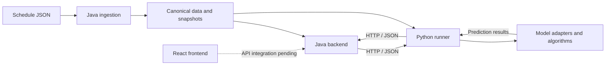

# GameSense: Sports Prediction Platform

GameSense is a college football prediction platform built with React, Java, and
Python. It turns historical schedules and game results into shared team/game
records, runs prediction models against that data, and returns winner predictions,
confidence values, and model-specific diagnostics.

The data ingestion and Java-to-Python prediction pipeline are implemented. The
frontend currently provides the application layout and navigation; connecting
those screens to live data and prediction results is still in progress.

## Current capabilities

- **Historical ingestion:** reads schedule JSON, maps teams, conferences, and
  games into canonical records, interprets locations and results, deduplicates
  games, and reports skipped records. Ingestion currently returns in-memory data;
  local tooling can export it as JSON snapshots.
- **Prediction orchestration:** supports existing games and custom matchups,
  validates their inputs, and executes configured models sequentially. Results
  retain individual successes and categorized failures, including service errors,
  timeouts, and invalid responses.
- **Python execution framework:** provides immutable snapshot contexts, explicit
  model registration, capability checks, request/result validation, and a common
  adapter interface for prediction algorithms.
- **Shared contracts:** JSON schemas and example payloads define teams, games,
  matchups, model executions, predictions, simulations, and errors. Some contracts
  describe planned API shapes rather than endpoints that are already available.
- **Frontend foundation:** responsive navigation, routing, and a Games page with
  Upcoming Games and Game Breakdown regions. These regions are placeholders;
  other routes currently have blank content areas.

## Architecture

| Component          | Technology                            | Responsibility                                                                      |
| ------------------ | ------------------------------------- | ----------------------------------------------------------------------------------- |
| Frontend           | JavaScript, React, React Router, Vite | Application presentation and navigation                                             |
| Backend            | Java 17, Spring Boot, Maven           | Canonical data, ingestion, validation, orchestration, and Python HTTP communication |
| Prediction service | Python 3.12+, FastAPI, Uvicorn        | Model registration, snapshot access, execution, and standardized results            |
| Shared contracts   | JSON Schema                           | Common data formats and cross-service validation rules                              |



The backend resolves game and team identities through `PredictionDataProvider`
and sends execution requests through `PythonPredictionClient`. Python retrieves
the referenced snapshot and calls the registered model's adapter. Each adapter
implements `get_descriptor()` and `execute(request, context)`, keeping model
calculations separate from transport and orchestration.

Results carry model identity, execution and snapshot IDs, timing, and either a
prediction or an error. Collecting multiple model outcomes does not yet combine
them into an ensemble prediction. The project currently uses local/in-memory data
and JSON snapshots; there is no database-backed application storage.

## Prediction models

Six model packages are implemented:

| Model                                                                               | Model ID           | Behavior                                                                        |
| ----------------------------------------------------------------------------------- | ------------------ | ------------------------------------------------------------------------------- |
| [Elo](prediction/src/gamesense_prediction/models/elo/README.md)                     | `elo-v1`           | Replays completed games to calculate ratings and a matchup probability          |
| [Glicko-2](prediction/src/gamesense_prediction/models/glicko/)                      | `glicko2`          | Uses ratings and rating deviations to estimate matchup outcomes                 |
| [Bradley-Terry](prediction/src/gamesense_prediction/models/bradley_terry/README.md) | `bradley-terry-v1` | Fits relative team strengths from completed game outcomes                       |
| [Monte Carlo](prediction/src/gamesense_prediction/models/monte_carlo/README.md)     | `monte-carlo-v1`   | Simulates scores from team scoring history and returns win probabilities        |
| [Coin flip](prediction/src/gamesense_prediction/models/coin_flip/README.md)         | `coin-flip-v1`     | Provides a seeded fair-coin simulation baseline                                 |
| [XGBoost](prediction/src/gamesense_prediction/models/xgboost/README.md)             | `xgboost-v1`       | Trains a classifier on historical features and performs deterministic inference |

Models share the same execution contract but have different history, training,
and execution-mode requirements. Availability over HTTP depends on startup
registration: the standard Python entry point currently registers coin flip;
local examples demonstrate the other models, including an all-model service.
XGBoost remains a proof of concept. Implemented models and passing execution
tests do not establish predictive accuracy; chronological evaluation and
probability calibration remain further work.

## Repository layout

```text
frontend/       React application, styles, and frontend tests
backend/        Spring Boot application, ingestion, HTTP client, and orchestration
prediction/     FastAPI service, model packages, training scripts, and tests
shared/         JSON schemas, example payloads, and schema validation tooling
config/         Shared code-quality configuration
.github/        CI workflows
docs/           Architecture, coding standards, and decision records
```

## Local development

Requirements are JDK 17, Python 3.12 or newer, and Node.js 22.12 or newer with npm.
The backend includes a Maven wrapper. Each application has its own dependency
installation and startup instructions:

- [Frontend setup](frontend/README.md): run the standalone UI, usually on port 5173.
- [Backend setup](backend/README.md): build and run Spring Boot, normally on port 8080.
- [Prediction service setup](prediction/README.md): install Python dependencies and
  run FastAPI, normally on port 8000. Startup requires `PREDICTION_SNAPSHOT_PATH`.

The backend exposes `GET /health`. Python exposes `GET /health` and
`POST /model-executions`. Backend orchestration is disabled by default until a
canonical data provider and model selections are supplied. Starting the services
does not automatically ingest a schedule or request a prediction.

For a working schedule-to-prediction walkthrough, see [demo.md](demo.md). It uses
opt-in backend endpoints and a separate Python entry point without requiring
frontend integration.

## Testing and code quality

GitHub Actions runs Java, Python, frontend, shared-schema, and Markdown checks.
The workflow includes JUnit, pytest, Vitest, Checkstyle, Spotless, Ruff, ESLint,
Prettier, and a frontend production build. Shared-contract checks validate both
schemas and example payloads.

Tests cover data mapping, input validation, orchestration outcomes, HTTP
communication, prediction contracts, and model behavior. See
[CONTRIBUTING.md](CONTRIBUTING.md) for local check commands, branch conventions,
and the review process.

## Work still in progress

The next integration work includes populating the frontend with game data and
prediction results, connecting application-facing APIs, and extending the local
data flow into ongoing season-data management. Model evaluation, prediction
aggregation, and persistent application storage are not completed by the current
execution framework. Architecture documents include proposed features as well
as implemented components.

## Documentation

- [Architecture](docs/architecture/README.md): component design and integration guides.
- [Domain model](docs/architecture/domain-model.md): shared entities and relationships.
- [Shared contracts](shared/README.md): schemas, examples, and validation.
- [Model development](docs/architecture/prediction-model-development.md): adapter and runner integration.
- [Code standards](docs/standards/README.md): language conventions and quality tooling.
- [Decision records](docs/decisions/README.md): documented architectural choices.
